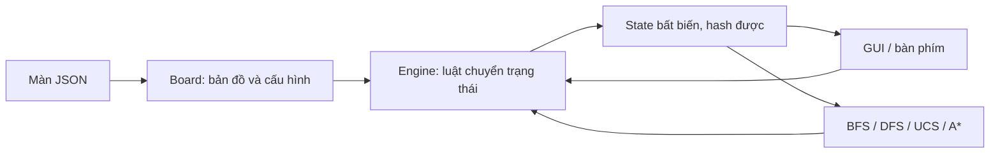

# Bloxorz engine

Game web 3D với engine và bốn thuật toán tìm kiếm viết bằng Python 3.10 trở lên, dùng thư viện chuẩn. Giao diện HTML/CSS/JavaScript dùng Three.js 0.170.0 để dựng cảnh WebGL2. Dựa trên luật trong `AI - Project 1.pdf`.

Chạy `python main.py` để mở game tại `http://127.0.0.1:8000`. Dùng `python main.py --port 8001` nếu cổng bận; `--no-browser` để chỉ chạy server. Không cần pip/npm hoặc Internet khi chơi. Cần trình duyệt hỗ trợ WebGL2, ví dụ Chrome/Edge.

Mũi tên/WASD hoặc nút trên màn hình để lăn khối, click vào khối con hoặc Space để đổi khối, R chơi lại. Khối đang chọn có viền xanh và chỉ số 1/2 hoặc 2/2 dưới bàn chơi. Rê chuột vào ô đặc biệt (hoặc click/chạm) để xem chú thích; chú thích ký hiệu cũng nằm dưới bản đồ. Chọn màn trong danh sách hoặc nhấn Màn tiếp. Kéo cảnh để xoay ngang trong khoảng −45° đến +45° nhằm giữ hướng điều khiển trực quan, cuộn để thu phóng. Hướng điều khiển luôn theo hàng/cột bàn chơi, không đổi khi xoay camera. Nhấn Góc nhìn để về góc ban đầu.

Chọn BFS/DFS/UCS/A* để tìm đường từ trạng thái hiện tại, sau đó nhấn Xem lời giải để phát lại. Server chỉ lắng nghe localhost, lưu ván chơi trong bộ nhớ theo cookie của trình duyệt; các tab cùng trình duyệt chia sẻ ván chơi. Khởi động lại server làm mất ván đang chơi.

Soft switch là nút bát giác xanh ngọc có vòng tròn trắng: bất kỳ phần nào của khối đứng, nằm ngang/dọc hoặc khối con đè lên đều kích hoạt cầu, không làm sập ô. Sàn yếu màu vàng chỉ sập khi khối nguyên đứng lên; cả sàn và khối rơi cùng nhau. Ô tách dùng ký hiệu (). Hiệu ứng công tắc và cầu chạy cùng cú lăn; đi qua sàn dễ vỡ bằng khối nằm/khối con không thêm hiệu ứng chờ. Cầu đóng gập xuống từ mép tiếp giáp sàn. Thời gian rơi ở mép là 0,75 giây, rơi tự do 0,42 giây.

## Thiết kế



`main.py` mở `server.py`; server phục vụ thư mục `web/`. Frontend gửi action qua `/api/move`, tải ván qua `/api/game`, chơi lại/đổi màn qua `/api/reset`, tìm lời giải qua `/api/solve`. Python giữ trạng thái và kiểm tra mọi nước đi; JavaScript chỉ hiển thị và nội suy animation. Vòng render của Three.js tách khỏi logic theo lượt. Lời giải được phát lại bằng chính API di chuyển, không có bộ luật JavaScript thứ hai.

## Đọc engine và phân chia công việc

Phần luật game được tách để mỗi file có một nhiệm vụ:

| File | Nội dung |
|---|---|
| `bloxorz/models.py` | `Action`, `State`, `Switch`: dữ liệu dùng chung, không sửa tại chỗ |
| `bloxorz/board.py` | `Board`: sơ đồ cố định, tra ô và kiểm tra cấu hình |
| `bloxorz/levels.py` | Đọc JSON: `load_board()`, `parse_board()`, `load_levels()` |
| `bloxorz/engine.py` | Tính nước đi, sàn đỡ, công tắc, tách/gộp và sự kiện animation |
| `bloxorz/solvers/*.py` | Bốn thuật toán do từng thành viên triển khai |
| `bloxorz/solver.py` | Chọn thuật toán, đo thời gian/bộ nhớ, giới hạn thời gian |

Người viết thuật toán vẫn dùng `from bloxorz import Engine, State, Action`. Ba hàm cần đọc trước là `initial_state()` (bắt đầu), `successors(state)` (các nước hợp lệ) và `is_goal(state)` (kiểm tra đích). `step()` trả trạng thái mới hoặc `None`; `transition()` còn trả sự kiện để giao diện diễn hoạt. Các import cũ từ `bloxorz.engine`, `Board.load()` và `Board.from_dict()` tiếp tục dùng được.

Trong `engine.py`, `transition()` mô tả thứ tự xử lý bằng năm bước có chú thích tiếng Việt: tính vị trí sau thao tác; kiểm tra sàn đỡ; xử lý đổi khối điều khiển; kích hoạt công tắc/tách khối; kiểm tra sàn sau khi cầu thay đổi. Các hàm nhỏ bên dưới xử lý riêng lăn khối nguyên, di chuyển khối con, tự ghép, kiểm tra từng ô và tác động cầu. Không cần sửa engine khi viết lại BFS/DFS/UCS/A*.

## Thuật toán và số liệu

**Bàn giao viết lại thuật toán:** bốn file `bloxorz/solvers/bfs.py`, `dfs.py`, `ucs.py`, `astar.py` đã được xóa. Game vẫn chơi tay được; gọi thuật toán chưa có sẽ báo rõ file cần tạo. Khởi động lại server sau khi thêm hoặc sửa thuật toán.

Mỗi người tạo lại file được phân công và cung cấp hàm `search(engine, start, deadline)`. Dùng `engine.successors(state)` để sinh bước đi, `engine.is_goal(state)` để kiểm tra đích; dùng toàn bộ `State` làm khóa để giữ thông tin cầu và khối đang chọn. `deadline` mặc định là vô hạn. Hàm trả dict gồm `status` (`solved`, `no_solution`, hoặc `timeout` khi có deadline), `actions` (danh sách chuỗi thao tác), `expanded`, `length`, `cost`; khi không có lời giải, `actions=[]`, `length=None`, `cost=None`.

`bloxorz/solver.py` giữ phần gọi thuật toán và đo thời gian/bộ nhớ. `solvers/common.py` giữ `edge_cost(engine, state)` với chi phí `1 + số ô dễ vỡ khối chiếm sau thao tác`, và `finish(found, parents, costs, expanded, status)` để dựng kết quả. Với helper này, `parents[start]=None`, các mục còn lại là `(trạng thái trước, Action)`, còn `costs` chứa chi phí tích lũy. A* cần heuristic phù hợp với hàm chi phí và xử lý đúng dịch chuyển/tách khối. Các kiểm thử thuật toán được giữ lại để đối chiếu sau khi cài đặt lại; chúng chưa thể đạt khi các file còn thiếu.

GUI hiển thị thời gian tìm kiếm, bộ nhớ Python đỉnh qua `tracemalloc`, số node mở rộng, độ dài và chi phí. Đo bộ nhớ không bao gồm trình duyệt, GPU hoặc toàn bộ RSS tiến trình. Theo dõi bộ nhớ làm tăng thời gian đo; dùng cùng cách đo cho cả bốn thuật toán. Tìm kiếm không giới hạn thời gian; thời gian đo gồm cả chờ khóa đo bộ nhớ. Màn khó, đặc biệt với DFS/IDS, có thể chạy lâu. Giao diện hiển thị số liệu của lần chạy hiện tại; phần lưu lịch sử, thống kê trung bình và biểu đồ đã được bỏ.

- `Board`: dữ liệu màn cố định, kiểm tra cấu hình lúc tải.
- `State`: các ô khối chiếm, nhóm cầu đang mở, cờ tách và chỉ số khối con đang được điều khiển. Tọa độ luôn được engine sắp xếp theo hàng rồi cột. Một ô là khối đứng; hai ô liền nhau là nằm ngang/dọc; hai khối con không liền nhau là trạng thái tách.
- `Engine.step(state, action)`: trả về trạng thái mới hoặc `None` nếu nước đi không hợp lệ. Không sửa trạng thái đầu vào. GUI có thể dùng `None` để phát hiệu ứng thua rồi cho chơi lại; solver bỏ qua cạnh đó.
- `Engine.successors(state)`: sinh các cặp `(action, state)` hợp lệ. Mọi thuật toán tìm kiếm dùng cùng hàm này, dùng trực tiếp `State` làm khóa visited. Chi phí cạnh và heuristic thuộc solver.
- `Engine.is_goal(state)`: chỉ thắng khi khối nguyên đứng trên đích. Trạng thái thắng không có successor.

### Quy tắc xử lý một nước đi

1. Tính vị trí và hướng mới; với khối tách, chỉ di chuyển khối đang chọn. Hai khối con liền cạnh tự ghép thành khối nằm.
2. Kiểm tra toàn bộ ô đỡ theo trạng thái cầu hiện tại. Khối nguyên đứng trên `F` là nước đi không hợp lệ; khối nằm và khối con được phép trên `F`.
3. Kích hoạt công tắc vừa được nhấn. Công tắc mềm nhận mọi kiểu khối; công tắc nặng và tách chỉ nhận khối nguyên đứng.
4. Áp dụng hiệu ứng cầu, dịch chuyển/tách khối nếu có, rồi xử lý công tắc mềm ở vị trí đáp xuống.
5. Kiểm tra lại ô đỡ sau hiệu ứng. Nếu cầu đóng ngay dưới khối, trả về `None`.

Đề bài không quy định chi tiết thời điểm tái kích hoạt nên engine dùng quy ước: một công tắc chỉ kích hoạt khi chuyển từ không bị nhấn sang bị nhấn; giữ khối trên công tắc không kích hoạt lặp. Hai công tắc tác động cùng nhóm cầu được xử lý theo thứ tự trong JSON. Đổi khối điều khiển không nhấn lại công tắc và được tính là một action; solver tự quyết định chi phí action này. Vị trí dịch chuyển phải nằm trên ô đỡ cố định, không phải cầu; nếu hai vị trí liền cạnh thì ghép lại ngay.

### Bảng chuyển hướng

`(r, c)` là ô trên/trái của khối. `S`: đứng, `H`: nằm ngang, `V`: nằm dọc.

| Hướng khối | Up | Down | Left | Right |
|---|---|---|---|---|
| S | V(r−2,c) | V(r+1,c) | H(r,c−2) | H(r,c+1) |
| H | H(r−1,c) | H(r+1,c) | S(r,c−1) | S(r,c+2) |
| V | S(r−1,c) | S(r+2,c) | V(r,c−1) | V(r,c+1) |

## Sử dụng

Chạy từ thư mục gốc dự án:

```python
from bloxorz import Board, Engine

engine = Engine(Board.from_dict({"rows": ["S..G"]}))
state = engine.initial_state()
for action in ("right", "right"):
    next_state = engine.step(state, action)
    if next_state is not None:
        state = next_state
assert engine.is_goal(state)
```

GUI giữ `state` hiện tại, gọi `step` theo phím mũi tên; phím cách gửi `switch`. Restart gọi `initial_state()`. Engine nhận trạng thái do chính nó tạo; không dùng `State` tự tạo từ dữ liệu bên ngoài chưa được kiểm tra.

## Định dạng màn

Game chỉ nạp 43 màn tự thiết kế từ `levels/testcases.json`. File có danh sách `groups`; mỗi nhóm có danh sách `cases`, mỗi testcase gồm `id`, `name` và `board`. Danh sách chọn màn chỉ hiển thị các testcase này, mặc định mở B01. `Board.from_dict()` chuyển trường `board` đến `parse_board()`; engine, game và cả bốn solver dùng chung đối tượng `Board`. Ví dụ cấu hình `board`:

```json
{
  "rows": [
    "S..oBB.G",
    "...F....",
    "..h.x...",
    "........"
  ],
  "bridges": {"gate": [[0, 4], [0, 5]]},
  "switches": [
    {"cell": [0, 3], "effects": {"gate": "toggle"}},
    {"cell": [2, 2], "effects": {"gate": "open"}},
    {"cell": [2, 4], "destinations": [[3, 1], [3, 6]]}
  ]
}
```

`id` định danh testcase và được dùng khi chọn màn hoặc chạy benchmark; `name` là tên hiển thị. Trường `board` chỉ chứa cấu hình bàn chơi. Các trường cấu hình tùy chọn được bỏ nếu không dùng.

| Ký hiệu trong `rows` | Ý nghĩa |
|---|---|
| Khoảng trắng | Ô trống, không có sàn |
| `.` | Sàn thường |
| `S` | Điểm bắt đầu, đúng một ô |
| `G` | Đích, đúng một ô |
| `F` | Sàn dễ vỡ |
| `B` | Cầu, được khai báo trong `bridges` |
| `o` | Công tắc mềm |
| `h` | Công tắc nặng |
| `x` | Công tắc tách |

Hàng phải cùng chiều dài, kể cả khoảng trắng ở cuối. Tọa độ luôn là `[hàng, cột]`, bắt đầu từ 0. `bridges` ánh xạ tên nhóm sang danh sách ô cầu. Mọi cầu mặc định đóng; `initially_open`, ví dụ `["gate"]`, liệt kê nhóm mở ban đầu. Không còn phân biệt `b/B` trên sơ đồ.

Mỗi ô `o`, `h`, `x` cần một mục `switches` có `cell`; loại công tắc được suy ra từ ký hiệu trên sơ đồ, không khai báo `kind` lặp lại. Công tắc mềm/nặng dùng `effects`, ví dụ `{"gate": "open", "exit": "close"}`; các tác động hợp lệ là `toggle`, `open`, `close`. Thứ tự công tắc được giữ nguyên. Công tắc tách dùng `destinations` chứa đúng hai điểm đến và `active` bằng 0 hoặc 1 (mặc định 0) để chọn khối con theo thứ tự điểm đến. Không còn mảng `teleports` riêng hoặc các chỉ số cầu khó đọc.

Bộ đọc từ chối trường lạ, ký hiệu không hợp lệ, tọa độ ngoài bản đồ, nhóm cầu không tồn tại và cấu hình thiếu công tắc. Cả 43 testcase sử dụng cùng định dạng bàn chơi.

## Phong cách và chuyển động

`web/art.js` dựng ô cỏ xanh ngọc, vách đá xanh sẫm, cây tùng và đảo trang trí bằng hình học low-poly. Khối trắng và giếng đích viền san hô để dễ nhận biết. Các đảo có cây ngoài bàn chơi chỉ là phong cảnh, không có ô đỡ. Bàn chơi vẫn là lưới vuông đúng sơ đồ level.

Engine cung cấp `landing`, các ô đỡ và sự kiện công tắc/cầu trong `transition()`; `step()` vẫn giữ API cũ cho solver. Giao diện lấy dữ liệu đó để diễn hoạt, không tự quyết định luật:

- Khối chỉ còn một ô đỡ nghiêng quanh mép ô đỡ hướng về ô trống, sau đó rời mép với vận tốc tiếp tuyến và rơi dưới trọng lực. Không còn ô đỡ thì rơi tự do. Chỉ khối con đang di chuyển bị rơi khi đang tách.
- Công tắc lún và phát vòng sáng khi được kích hoạt; cầu gập xuống hoặc mở lên theo sự kiện thật.
- Ô dễ vỡ nhẹ nhàng võng khi khối nằm, nứt/sụp khi khối đứng; tách khối có hiệu ứng thu vào và hiện ở hai vị trí đích; ghép khối có nhịp nén nhỏ. Khi thắng, khối chìm và mờ dần, phần dưới mặt giếng được cắt khỏi hình ảnh; cột cờ dựng lên và pháo bông xuất hiện. Chế độ giảm chuyển động chỉ hiện cờ tĩnh.
- Diễn hoạt phụ thuộc thời gian, hỗ trợ `prefers-reduced-motion`. Phần toán chuyển động ở `web/motion.js` có kiểm thử bằng Node.

Mô hình rơi dùng tiếp xúc mép cố định tới lúc rời mép; không mô phỏng trượt, ma sát hoặc va chạm với vách đá sau khi rơi. Đây là diễn hoạt cho game theo lượt, không thay đổi kết quả hợp lệ/thua của engine.

## Tập testcase cho báo cáo thực nghiệm

File `levels/testcases.json` chứa **43 màn tự thiết kế**: bốn nhóm có lời giải, mỗi nhóm 10 màn, và một nhóm riêng gồm 3 màn vô nghiệm:

| Nhóm | Ca | Mục tiêu |
|---|---|---|
| Cơ bản | B01–B10 | Sàn thường/ô trống; lời giải ngắn nhất 4–8 lần lăn |
| Sàn dễ vỡ | F01–F10 | Đi qua ô dễ vỡ đúng tư thế; 9–13 lần lăn |
| Công tắc/cầu | S01–S10 | Phối hợp công tắc mềm/nặng, cầu toggle/open; 15–17 lần lăn |
| Kết hợp | M01–M10 | Tách/ghép, sàn yếu, công tắc và cầu; 28–37 lần lăn |
| Không có đường đi | N01–N03 | Đích tách rời; ô dễ vỡ chặn điểm đứng bắt buộc; cầu đóng với công tắc ở phía bên kia |

Mỗi `board` dùng định dạng hiện có của game. Độ dài lời giải chỉ tính các lần lăn lên, xuống, trái, phải. Đổi khối bằng Space hoặc click không tăng số nước đi và không cộng chi phí. Solver dùng `search_successors()` trong `bloxorz/solvers/common.py` để gộp chọn khối với một lần lăn, dựa trên `Engine.successors()`. Chuỗi phát lại vẫn giữ `switch` khi cần. Các nhóm tăng dần về cơ chế và khoảng độ dài; các ca trong một nhóm không nhất thiết được sắp theo số lần lăn. Thời gian chạy không nhất thiết tăng theo nhóm. Nhóm vô nghiệm kiểm tra thuật toán duyệt hết trạng thái và trả `no_solution`; số bước và chi phí để trống khi xuất kết quả.

Trong **Danh sách testcase** dưới bàn chơi, chọn một hoặc nhiều thuật toán (BFS, DFS/IDS, UCS, A*), chọn nhóm và đánh dấu các màn cần chạy. **Mở màn** cho phép chơi thử. **Chạy danh sách** chỉ chạy các thuật toán đã chọn từ trạng thái đầu của mỗi màn, không thay đổi ván đang chơi; mỗi lượt không giới hạn thời gian. Phải chọn ít nhất một thuật toán và một màn; lựa chọn được khóa trong lúc chạy. Dừng danh sách sẽ đợi thuật toán hiện tại hoàn tất rồi không chạy các lượt tiếp theo. Bảng ghi trạng thái, thời gian, bộ nhớ đỉnh, node mở rộng, số bước và chi phí. **Xuất CSV/JSON** xuất cả kết quả timeout/vô nghiệm và chuỗi hành động; giữ nguyên ô trống cho số liệu không có. Kết quả chỉ giữ trong phiên trang, lần chạy mới thay bảng cũ; xuất trước khi chạy lại hoặc tải lại trang.

## Kiểm thử

```powershell
python -m unittest discover -s tests -v
node tests/motion.test.mjs
node tests/victory.test.mjs
node tests/testcases.test.mjs
```

Kiểm thử tương thích đối chiếu trạng thái và sự kiện animation với bản tham chiếu của 43 testcase, trên tối đa 300 trạng thái có thể đến ở mỗi màn. Bao phủ 12 phép lăn và phép đảo, biên/void, thắng, ô dễ vỡ, cầu đóng/mở, công tắc mềm/nặng, hiệu ứng cố định, tách/đổi điều khiển/ghép, công tắc tại điểm dịch chuyển và dữ liệu màn không hợp lệ.

Kiểm thử web chạy cả bốn solver trên các nhóm testcase, phát lại kết quả bằng engine, đối chiếu chi phí UCS/A*, timeout, màn vô nghiệm, API chơi thắng/thua, phiên độc lập, input sai và chặn POST từ origin khác. Danh sách chọn màn được đối chiếu với đủ 43 testcase và từ chối các ID màn cũ.

Three.js được lưu trong `web/vendor/`, kèm giấy phép MIT. Tham khảo API chính thức: [WebGLRenderer](https://threejs.org/docs/pages/WebGLRenderer.html), [OrthographicCamera](https://threejs.org/docs/pages/OrthographicCamera.html). GUI desktop Tkinter đã được thay thế bằng web 3D.
